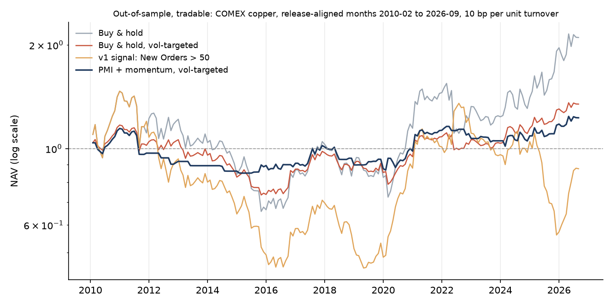

# Copper futures vs. China manufacturing PMI: which PMI component leads copper, and by how much?

A Python time-series model that tests whether China's manufacturing PMI and its sub-indices lead
copper futures returns, and identifies the component and horizon the data supports. On the
internship data the answer was the **New Orders sub-index, one month ahead**; this repository is the
reproducible version of that study, built to be rerun on any monthly sample.

Built from the CITIC Futures winter internship project (Dec 2025 to Jan 2026). The first version was a
12-month OLS; this one applies the standard monthly macro toolkit to ten-plus years of data, compares
every PMI component on the same footing, and evaluates the finding out of sample.

## v2: tradable, out-of-sample (`copper_pmi_v2.py`)

v1 measured copper returns from monthly-average prices. Averaging makes returns autocorrelated by
construction (Working, 1960) and is not a price anyone can trade, so v2 rebuilds the study on daily COMEX
copper futures (HG=F) with release-aligned months: enter at the close of the 2nd trading day of month m,
when the NBS PMI for m-1 is already public, and exit on the 2nd trading day of m+1. On top of that:

| Change | Reference |
|---|---|
| Benchmark = prevailing historical mean; out-of-sample R^2 | Welch & Goyal (2008); Campbell & Thompson (2008) |
| Clark-West test for nested forecasts (replaces Diebold-Mariano vs a zero forecast) | Clark & West (2007) |
| Equal-weight combination of all PMI component forecasts, with the sign restriction | Rapach, Strauss & Zhou (2010); Campbell & Thompson (2008) |
| 12-month time-series momentum, blended 50/50 with the PMI signal | Moskowitz, Ooi & Pedersen (2012) |
| 10% volatility target on trailing 63-day realised vol, 2x cap | Moreira & Muir (2017) |

Every parameter is fixed in advance at the value used in those papers, and every variant is reported.

**Results (2005-02 to 2026-09; out-of-sample from 2010-02, 200 months, 10 bp per unit of turnover):**

| | Monthly-average returns (v1) | Tradable returns (v2) |
|---|---|---|
| AR(1) autocorrelation of copper returns | 0.336 | 0.103 |
| Correlation with last month's New Orders (index minus 50) | 0.231 | 0.156 |

| Strategy | CAGR | Vol | Sharpe | Max drawdown |
|---|---|---|---|---|
| Buy & hold | 4.6% | 22.6% | 0.31 | -55.2% |
| v1 signal: New Orders > 50 long, else short | -0.8% | 22.6% | 0.08 | -69.3% |
| PMI combination forecast | 0.9% | 22.7% | 0.16 | -54.1% |
| 12-month momentum | 1.5% | 22.7% | 0.18 | -63.4% |
| PMI + momentum, 10% vol target | 1.2% | 8.4% | 0.19 | -25.8% |

What this says:

- Part of the one-month lead found in v1 comes from monthly averaging. On tradable returns the New Orders
  sign rule earns a Sharpe of 0.08 out of sample.
- The PMI levels still carry some information: the combination forecast has an out-of-sample R^2 of 0.88%
  per month (pmi and production levels about 1.06%), above the 0.5% Campbell-Thompson threshold for
  economic value, but the Clark-West test does not reject the historical mean (p = 0.20).
- No timing rule beats buy-and-hold on Sharpe over 2010-2026; combining PMI with momentum and targeting
  volatility cuts the maximum drawdown from -55% to -26%. PMI is best used as one input to a risk overlay,
  not as a stand-alone directional signal.

Full tables, forecasts and returns are in `results_v2/` (`report_v2.md`, `nav_v2.png`).



## Method (v1)

| Step | Method | Question it answers |
|---|---|---|
| 1 | ADF and KPSS tests | Which series are stationary, so models run on returns and index changes, not price levels |
| 2 | Lead-lag cross-correlation, k = -6..+6, both forms (index minus 50, and month-on-month change), with the 1.96/sqrt(n) band | At what horizon each component co-moves with copper returns |
| 2b | Sub-index ranking: every PMI component, both forms, correlation at lead 1 and Granger p at lag 1 | Which component is the one-month leading indicator |
| 3 | Granger causality, both directions, lags 1-6 | Does the component forecast copper beyond copper's own past, and not the reverse |
| 4 | VAR with BIC lag selection, orthogonalised impulse responses | Dynamic response of copper to a component shock |
| 5 | Lagged regression with Newey-West (HAC) standard errors | Size and significance of each lag, robust to autocorrelation |
| 6 | Expanding-window out-of-sample forecasts; RMSE vs random walk and historical mean; Diebold-Mariano test; hit rate | Is the predictive content real out of sample |
| 7 | Signal backtest with transaction costs; Sharpe, drawdown | Economic significance |

The signal used in steps 6 and 7 (which component, which form) is chosen on the first 60 months only, so
the evaluation period never informs the choice.

Outputs in `--out`: `report.md` (headline paragraph plus every table), one CSV per step, `var.json`, and
figures `levels.png`, `lead_lag.png`, `var_irf.png`, `oos_forecast.png`, `backtest.png`.

## Run

```bash
python3 -m venv .venv && ./.venv/bin/pip install pandas numpy scipy statsmodels matplotlib tabulate
./.venv/bin/python copper_pmi_ts.py --demo --out results_demo                      # synthetic data, checks the pipeline
./.venv/bin/python copper_pmi_ts.py --pmi data/pmi.csv --copper data/copper.csv --out results
./.venv/bin/python copper_pmi_v2.py --out results_v2                                   # v2, uses data/pmi.csv and data/copper_daily.csv
```

## Data

- `data/pmi.csv` and `data/copper_daily.csv` ship with the repo: NBS manufacturing PMI and four sub-indices
  (2005-01 to 2026-10, via akshare) and daily COMEX copper futures closes (HG=F, via yfinance).
  `python copper_pmi_v2.py --fetch` downloads fresh copies.
- `data/pmi.csv`: `date,pmi,new_orders[,production,new_export_orders,raw_material_inventories,employment,...]`.
  Monthly NBS manufacturing PMI and sub-indices in percent; every extra column is tested as a candidate.
  Source: National Bureau of Statistics monthly PMI release (Wind and Choice export all components).
- `data/copper.csv`: `date,price`. SHFE copper main contract (CNY/t) monthly average or month-end, or LME
  3-month copper (USD/t). FRED series PCOPPUSDM (global copper price, monthly) also works.
- Dates may be any day of the month; everything is aligned to month end. At least 36 overlapping months
  are required; 120 or more is what the tests need to be meaningful.
- `--fetch` tries akshare (headline PMI) and FRED (copper) and tells you what to supply by hand if a
  download fails; the sub-indices come from `data/pmi.csv`.

## What the demo shows

`--demo` generates 180 months in which only New Orders carries a one-month lead on copper returns
(production co-moves without extra lead, export orders are unrelated, inventories are weakly
counter-cyclical). A correct pipeline ranks New Orders (level) first with the highest lead-1 correlation
and a Granger p near zero, shows the cross-correlation peak at k = 1, finds copper does not Granger-cause
New Orders, and beats the random walk out of sample. Real data are noisier; read the p-values with the
sample size in mind.


## Reading the result on real data

- `report.md` opens with the component and horizon the data supports and the three numbers that back it:
  the lead-1 correlation with its white-noise band, the Granger p-value, and the out-of-sample RMSE
  against the random walk with the Diebold-Mariano p-value.
- A component that leads in the `level` form means the index being above or below 50 matters; in the
  `change` form it is the month's acceleration that matters. The ranking table shows both.
- Copper also responds to the US dollar, exchange inventories, policy and supply. The model isolates the
  PMI channel and does not control for those; the backtest is a sanity check of economic significance,
  not a trading strategy.

## References

- Campbell, J. Y. and Thompson, S. B. (2008). Predicting excess stock returns out of sample: can anything beat the historical average? *Review of Financial Studies* 21(4).
- Clark, T. E. and West, K. D. (2007). Approximately normal tests for equal predictive accuracy in nested models. *Journal of Econometrics* 138(1).
- Moreira, A. and Muir, T. (2017). Volatility-managed portfolios. *Journal of Finance* 72(4).
- Moskowitz, T. J., Ooi, Y. H. and Pedersen, L. H. (2012). Time series momentum. *Journal of Financial Economics* 104(2).
- Rapach, D. E., Strauss, J. K. and Zhou, G. (2010). Out-of-sample equity premium prediction: combination forecasts and links to the real economy. *Review of Financial Studies* 23(2).
- Welch, I. and Goyal, A. (2008). A comprehensive look at the empirical performance of equity premium prediction. *Review of Financial Studies* 21(4).
- Working, H. (1960). Note on the correlation of first differences of averages in a random chain. *Econometrica* 28(4).
